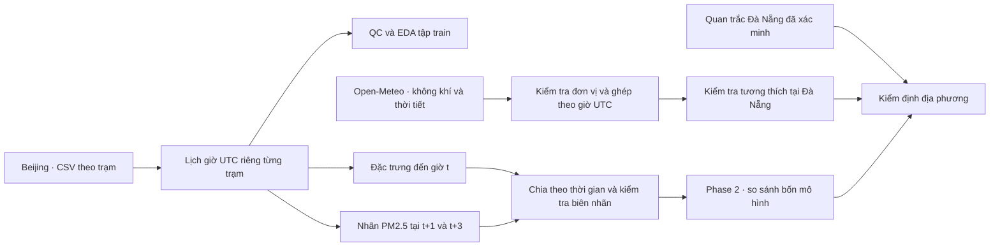

# Da Nang Air Quality AI

[Mở website Da Nang Air Quality AI](https://da-nang-air-quality-ai.nitia-gpt-pr-6208.chatgpt.site)

## Vận hành website

Giao diện React có năm trang, dùng cùng hợp đồng REST với hai cách triển khai. Bản Sites chạy API Worker và lưu dữ liệu vào R2. Đã kích hoạt đồng bộ vào phút 05 mỗi giờ theo giờ Việt Nam. Bản tự lưu trữ dùng FastAPI, PostgreSQL và APScheduler. Xem [hướng dẫn triển khai](docs/self-host.md), [phương pháp AQI và nguồn](docs/aqi_sources.md) và [quy trình đồng bộ bản Sites](site/OPERATIONS.md).

Dữ liệu Đà Nẵng là ước tính Open-Meteo/CAMS. Chỉ số hiển thị dùng US AQI do nguồn cung cấp. Khi mở [trang Dự báo AI](https://da-nang-air-quality-ai.nitia-gpt-pr-6208.chatgpt.site/#du-bao), hệ thống dùng đúng giờ hiện tại và sáu giờ trước tại 16,0544°B, 108,2022°Đ để dự báo PM2.5 sau 1 và 3 giờ. Các mốc hiển thị theo giờ Việt Nam. Nếu thiếu một giờ hoặc dữ liệu cũ, trang thông báo trạng thái.

Mô hình thử nghiệm địa phương `danang-cams-ridge-v1` học trên chuỗi PM2.5 CAMS tại Đà Nẵng (train năm 2024, validation nửa đầu 2025, test nửa cuối 2025). MAE test lần lượt là 1,01 và 2,61 µg/m³, so với persistence 1,05 và 2,49. Dự báo 3 giờ có sai số lớn hơn persistence trên tập test. Các sai số so với ước tính CAMS; độ chính xác so với thiết bị quan trắc địa phương còn chờ xác minh. [Kết quả theo chân trời](reports/danang-pilot/metrics.csv) · [Khảo sát nguồn đối chứng](docs/danang-observations.md)

Để tái huấn luyện, chạy `python -m ml.train_danang`. Artifact dùng cho FastAPI ở `reports/danang-pilot/model.json`. Khi phát hành phiên bản mới, sao chép artifact sang `site/worker/pilot-model.json` trước khi build. Hai artifact cần giống nhau. Mô hình Bắc Kinh bên dưới là thí nghiệm riêng.

## Phase 2 · Huấn luyện và kiểm định tại Bắc Kinh

Chạy các lệnh dưới đây từ thư mục dự án. Đầu vào là ZIP Beijing đã kiểm tra ở Phase 1. Mỗi lần chạy ghi kết quả vào `reports/phase2`. Có thể dùng `--out` để lưu một thí nghiệm riêng.

```powershell
python -m pip install -r requirements.txt
python -m ml.train
python -m unittest discover -s tests -v
```

[Báo cáo thực nghiệm](reports/phase2/RESULTS.md) trình bày kết quả và giới hạn. Trong [mã huấn luyện](ml/train.py), mỗi nhãn được tạo sau khi dựng lưới giờ của một trạm. Hai cửa sổ validation nội bộ bắt đầu vào tháng 3 và tháng 12 năm 2015, mỗi cửa sổ dài ba tháng. XGBoost chọn độ sâu và tốc độ học theo MAE trung bình hai cửa sổ, rồi lấy trung bình số vòng tốt nhất để fit lại trên train. Ridge và Random Forest dùng cấu hình cố định. Tất cả mô hình dự báo nồng độ với cận dưới bằng 0. `metrics.csv` lưu MAE, RMSE, R² và độ lệch trung bình (dự báo trừ thực đo). `folds.csv` lưu kết quả tìm tham số. `test_groups.csv` và `validation_importance.csv` phân tích mô hình đã chọn.

Mỗi chân trời có một model joblib và manifest ghi phiên bản, thứ tự feature, đơn vị, khóa tham chiếu tới hàm tạo feature, mốc chia và SHA-256 dữ liệu. Để chạy một dự báo ngoại tuyến trên trạm Beijing:

```python
from pathlib import Path
from ml.phase1 import read_archive, station_grid
from ml.inference import forecast

raw = read_archive(Path("data/raw/beijing.zip"))
grid, _ = station_grid(raw.loc[raw.station == "Aotizhongxin"])
for horizon in (1, 3):
    print(forecast(grid, grid.index[-1], horizon, region="Beijing"))
```

Hàm nhận bảng chuẩn hóa của **một trạm**, lấy đúng bảy mốc giờ kết thúc tại giờ phát. Trạng thái `insufficient_data` cho biết thiếu đầu vào. `region_not_validated` áp dụng cho Đà Nẵng. Dự báo hợp lệ có giờ phát, giờ đích, nồng độ và chênh lệch so với PM2.5 hiện tại. Quy ước mô tả tạm thời là ổn định khi chênh lệch tuyệt đối ≤ 1 µg/m³. Nhãn xu hướng này chưa được hiệu chuẩn về độ tin cậy.

## Phase 1 · Kiến trúc dữ liệu và EDA

Mục tiêu là xác định tập đầu vào có thể tái tạo khi phục vụ dự báo PM2.5 sau 1 giờ và 3 giờ, đồng thời định lượng số mẫu dùng được trước khi chọn mô hình.



## Chạy lại

Chạy từ thư mục chứa README, dùng Python 3.10 trở lên. Bản ZIP đã tải nằm tại `data/raw/beijing.zip`. Nếu cần tải lại, dùng liên kết Download tại [UCI](https://archive.ics.uci.edu/dataset/501/beijing+multi+site+air+quality+data). SHA-256 của bản đã phân tích là `b04da438b2f331ac0ffd45aebdfec0d20d2367feb5f6948c4b1f7ce1191e33c4`.

```powershell
python -m pip install -r requirements.txt
python -m ml.phase1 data/raw/beijing.zip
python -m unittest discover -s tests -v
python -m ml.probe
```

`ml/phase1.py` đọc cả ZIP phát hành lẫn ZIP PRSA bên trong. `station_grid` kiểm tra khóa và dựng lại lưới giờ cho từng trạm. `features` nhận lưới đã chuẩn hóa, còn `partitions` nhận giờ phát dự báo và chân trời. `reports/beijing/` chứa thống kê thiếu theo cột và trạm, độ phủ, phân bố, tương quan Pearson và số mẫu hợp lệ. `ml/probe.py` cần Internet, kiểm tra JSON của hai API và ghi đè `reports/danang_probe.json` với kết quả lần gọi gần nhất. Mã thoát khác 0 cho biết chưa tìm được giờ chung đủ dữ liệu.

## Kiến trúc dữ liệu

Một dòng gốc Beijing là một trạm tại một giờ. 18 cột gồm số thứ tự No, bốn thành phần lịch, tên trạm, sáu chất ô nhiễm và sáu trường khí tượng TEMP, PRES, DEWP, RAIN, wd, WSPM. UCI ghép khí tượng từ trạm thời tiết gần nhất. Thời kỳ từ 01/03/2013 đến 28/02/2017. Dùng giờ địa phương Asia/Shanghai để diễn giải lịch Beijing. [Bộ dữ liệu và từ điển UCI, CC BY 4.0](https://archive.ics.uci.edu/dataset/501/beijing+multi+site+air+quality+data)

Schema lưu lâu dài đề xuất dùng một dòng cho một đại lượng, tại một vị trí, giờ hiệu lực và phiên bản nguồn. Khi tạo đặc trưng mới chuyển sang bảng rộng.

| Trường | Ý nghĩa |
|---|---|
| source_id, kind | Phân biệt nguồn Beijing, API AQ, API thời tiết. Kiểu station_observation, atmospheric_model_estimate hoặc ml_prediction |
| location_id, station_id | Định danh điểm yêu cầu ổn định. station_id có thể rỗng cho dữ liệu lưới |
| requested_lat/lon, grid_lat/lon | Lưu riêng tọa độ yêu cầu và tâm lưới thực trả theo từng API. Chấp nhận tọa độ khuyết của trạm Beijing |
| valid_at_utc, source_timezone | Giờ hiệu lực để ghép, múi giờ bản địa để tạo đặc trưng lịch |
| fetched_at_utc, issued_at_utc | Giờ thu thập và giờ phát hành bản tin nếu nguồn cung cấp. Giữ phiên bản theo lần lấy |
| variable, value, unit, qc_flag | Giá trị rỗng khi thiếu hoặc bất hợp lệ, bảo toàn dữ liệu thô để truy vết |
| model_version, origin_utc, horizon_h | Áp dụng cho dự báo ML, phân biệt giờ chạy và giờ đích |

| Beijing | Open-Meteo | Trường mô hình / đơn vị |
|---|---|---|
| PM2.5, PM10 | pm2_5, pm10 | pm25, pm10 · µg/m³ |
| CO, NO2 | carbon_monoxide, nitrogen_dioxide | co, no2 · µg/m³ |
| SO2, O3 | sulphur_dioxide, ozone | so2, o3 · µg/m³ |
| TEMP | temperature_2m | temp_c · °C. Độ cao đo TEMP cần xác minh |
| DEWP | relative_humidity_2m | RH (%) chỉ phục vụ khảo sát. Beijing có điểm sương, chưa đưa RH vào bộ đặc trưng đầu tiên |

PRES, RAIN, wd, WSPM cần đối chiếu thêm độ cao, khoảng tích lũy và đơn vị trước khi mở rộng. No và station chỉ phục vụ truy vết, phân nhóm. CAMS qua Open-Meteo cung cấp ước tính theo lưới. Ghép hai nguồn theo điểm yêu cầu và thời gian UTC. Khi mô phỏng vận hành chỉ dùng phiên bản đã có ở thời điểm phát dự báo. Dữ liệu tải hồi cứu chưa chứng minh thời điểm sẵn có trong quá khứ. Ghi công Open-Meteo và CAMS khi sử dụng. [Air Quality API](https://open-meteo.com/en/docs/air-quality-api) · [Weather API](https://open-meteo.com/en/docs) · [Điều khoản](https://open-meteo.com/en/terms)

## Làm sạch và kết quả EDA

1. Đọc NA, kiểm tra trạm và timestamp, dừng khi trùng khóa. Sắp xếp từng trạm và chèn giờ khuyết trước khi dịch chuỗi.
2. Với trường mô hình, chuyển lỗi kiểu số, vô hạn và nồng độ âm thành thiếu. Giữ các đỉnh dương để rà soát theo trạm và bối cảnh. Trên train, PM2.5 có trung vị 56, trung bình 80,36, P99 bằng 361 và cực đại 999 µg/m³. Đuôi phải dài cần được đánh giá riêng.
3. Trong 420.768 dòng của 12 trạm, số giờ khuyết trong lưới từng trạm bằng 0. Tuy nhiên PM2.5 thiếu 8.739 giá trị và CO thiếu 20.701. Trên train, tương quan Pearson của PM2.5 với PM10 bằng 0,873 và với CO bằng 0,778. Đây là tương quan cùng giờ.
4. Tạo PM2.5 trễ 1, 3, 6 giờ và trung bình của 3, 6 giờ kết thúc tại t, yêu cầu đủ cả cửa sổ. Thêm sin/cos giờ và tháng địa phương. Chỉ giữ mẫu có đủ đầu vào và nhãn đúng chân trời. Khi phục vụ, thiếu đầu vào trả trạng thái chưa đủ dữ liệu.

## Thiết kế thực nghiệm Phase 2

Dùng chung mốc lịch Beijing cho 12 trạm. Train kết thúc trước 01/03/2016, validation từ 01/03 đến trước 01/09/2016, test bắt đầu 01/09/2016. Điều kiện là cả giờ phát lẫn giờ đích đều thuộc cùng tập. Lịch sử trước biên được dùng làm đầu vào nếu đã có tại giờ phát. Các tham số chuẩn hóa Ridge chỉ fit trên train.

| Số mẫu hợp lệ | t+1 | t+3 |
|---|---:|---:|
| Train | 274.239 | 273.241 |
| Validation | 46.528 | 46.323 |
| Test | 47.344 | 47.169 |

Huấn luyện riêng từng chân trời. Trên cùng tập dòng hợp lệ, so sánh persistence (dự báo bằng PM2.5 tại t), Ridge, Random Forest và XGBoost. Chọn tham số bằng các cửa sổ validation tiến dần bên trong train, áp dụng cùng quy tắc loại nhãn vượt biên. Kế hoạch XGBoost dùng squared error, cây histogram, seed cố định, thử max_depth 3/6, learning_rate 0,03/0,1, tối đa 1.000 vòng và dừng sớm sau 50 vòng theo MAE. Dùng validation chính để so sánh các ứng viên đã chốt tham số, ưu tiên MAE thấp hơn persistence và các đối chứng. Đánh giá test một lần sau khi khóa cấu hình.

Báo cáo MAE và RMSE bằng µg/m³, R², sai lệch trung bình, kết quả từng trạm, mùa, giờ và nhóm PM2.5 trên P95 của train. So sánh importance bằng hoán vị theo khối thời gian trên validation. Lưu thứ tự feature, đơn vị, múi giờ, quy tắc QC, ngày chia tập, seed và phiên bản mô hình cùng artifact. Với Đà Nẵng, trước hết so sánh phân bố và độ phủ đầu vào. Để đánh giá sai số thực địa cần ghép các dự báo lưu tại giờ phát với PM2.5 đo độc lập đúng giờ đích, vị trí và đơn vị, rồi so sánh lại với persistence trên cùng giờ. Tách giai đoạn hiệu chỉnh khỏi giai đoạn kiểm định sau cùng.

## Tiêu chí nghiệm thu Phase 1

Kiểm tra đủ 12 trạm, 420.768 dòng, 18 cột, số mẫu theo bảng, test biên thời gian và giờ khuyết đều đạt. Probe xác minh đơn vị sáu chất cùng hai biến thời tiết, loại các giờ tương lai và đếm số giờ ghép đủ. Số giờ thay đổi theo thời điểm gọi. Chưa xác minh quyền và endpoint dữ liệu trạm chính thức của Đà Nẵng. Đánh giá MAE, RMSE, R² và quyết định triển khai dự báo thuộc các bước sau.
